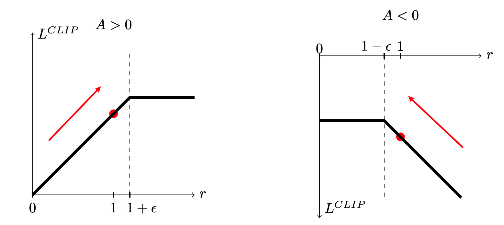

#### PPO-Clip 的目标函数

TRPO 解决了策略梯度算法的很多问题，但是实现和求解十分复杂，其复杂性很大程度上来自 KL 散度的约束 $\mathbb{E}_{s\sim\nu^\pi_\gamma}\left[ D_{KL}\left(\pi_\theta(\cdot|s),\pi_{\theta'}(\cdot|s)\right) \right]\leqslant \delta$ ，这在理论上是严格的，但是实践中不好用。

OpenAI 科学家 John Schulman 等人在2017年提出 Proximal Policy Optimization (PPO) 算法，他们注意到约束的本质是不希望新策略在离旧策略分布太远时还在改进，因此直接用 Clip 截断限制新策略和旧策略之间的距离，禁止分布偏离较大时的策略改进。这一方法简单而有效。

回顾 TRPO 的优化目标
$$
\max_\theta \mathbb{E}_{s\sim\nu^{\pi_k}_\gamma,\,a\sim\pi_k(\cdot|s)}\left[ \frac{\pi_\theta(a|s)}{\pi_{\theta_k}(a|s)}\hat A_{\pi_k}(s,a) \right]\quad\text{s.t.}\,\mathbb{E}_s[KL(\pi(\cdot|s),\pi_k(\cdot|s))]\leqslant\delta
$$
记 Probability ratio 
$$
r_t(\theta)=\frac{\pi_\theta(a_t|s_t)}{\pi_{\theta_k}(a_t|s_t)}
$$

> 这里 $\pi(\theta_k)$ 表示第 $k$ 轮更新时的锚点策略，或者叫旧策略 $\pi(\theta_{\text{old}})$.
>
> 显然，不做任何优化时，$r_t(\theta_k)=1$ .

重写 TRPO 的目标函数
$$
L(\theta)=\mathbb{E}_t \left[ \frac{\pi_\theta(a_t|s_t)}{\pi_{\theta_k}(a_t|s_t)}\hat A_{\pi_k}(s_t,a_t) \right]=\mathbb{E}_t\left[ r_t(\theta)\hat A_t\right]
$$

> $\mathbb{E}_t$ 表示在采样出的序列上求期望。抽象的数学公式最终落在算法实践中，总是要通过采样实际的序列来求期望的。

我们希望 $\max_\theta L(\theta)$ 的同时又限制 $\pi_\theta(\cdot|s)$ 不要偏离 $\pi_{\theta_k}(\cdot|s)$ 太远。注意到，当 $\hat A_{\pi_k}(s_t,a_t) > 0$ 时，$\max_\theta L(\theta)$ 会试图提高 $r_t(\theta)$ ；当 $\hat A_{\pi_k}(s_t,a_t)<0$ 时，$\max_\theta L(\theta)$ 会试图降低 $r_t(\theta)$ 。我们希望这种优化不要过界。何为过界呢？就是说，策略改进不要朝着 $\max_\theta L(\theta)$ 的方向走得太远：

- $\hat A_t>0$ 时，$r_t(\theta)$ 的提高不要超过 $1+\epsilon$ 
- $\hat A_t<0$ 时，$r_t(\theta)$ 的降低不要低于 $1-\epsilon$ 

其中 $\epsilon$ 是我们引入的一个超参数。PPO 引入了一个精妙的目标函数来精确实现这一点：
$$
L^{\text{CLIP}}(\theta)=\mathbb{E}_t\left[\min\left( r_t(\theta)\hat A_t,\text{clip}\left( r_t(\theta),1-\epsilon,1+\epsilon \right)\hat A_t \right)\right]
\label{ppoobj}
$$
这被称作 **surrogate objective**。

这个式子的内涵非常丰富。首先，第二项 $\text{clip}\left( r_t(\theta),1-\epsilon,1+\epsilon \right)\hat A_t$ 代表对 $r_t(\theta)$ 截断到 $1-\epsilon<r_t(\theta)<1+\epsilon$ ，这被称为 clipped objective，而第一项 $r_t(\theta)\hat A_t$ 是 unclipped objective，PPO 总的目标函数是取二者的极小值——最终的结果是 $L^{\text{CLIP}}(\theta)$ 构成 $L(\theta)$ 的一个悲观下界 (原文：a lower bound, i.e. a pessimistic bound) 。为什么称之为“悲观下界”呢？因为它恰好排除了所有使得 $L(\theta)$ 变得过好(过大)的 $r_t(\theta)$ ，而保留了所有使 $L(\theta)$ 变差的 $r_t(\theta)$ . 

这是一个非常有趣的解读，也就是说 PPO 的目标函数只优化不够好的 $\theta$ ，当 $\theta$ 已经比较好的时候，目标函数就发生了截断，使得继续改变 $\theta$ 也不会有性能提升。下图直观地展示了这一点，其中红色箭头代表 $\max_\theta L(\theta)$ 所代表的策略改进方向，可以直观看出 PPO-Clip 的核心思想：**策略不要朝着改进的方向走得太远**。

> 有人可能会问：为什么不能直接把 $r$ 截断在 $(1-\epsilon,1+\epsilon)$ 里，而是要取悲观下界呢？因为你的优化过程可能偶尔导致 $L$ 降低，即发生了负优化，例如 $A>0$ 但是 $r<1$ 甚至 $r<1-\epsilon$ . 悲观下界保证了这种情况下 PPO 算法能迅速修正处在错误方向（负改进方向）的 $r_t(\theta)$ .

#### 如何估计 $\hat A_{\pi_k}(s_t,a_t)$ ？GAE-$\lambda$

在 Actor-Critic 章节介绍过 TD-error of state value 
$$
\hat A_t=\delta_t=r_{t+1}+\gamma V_\omega (s_{t+1})-V_\omega(s_t)
$$
其实就是 Advantage 的一次采样估计。这种 1-step TD error 的方差小（因为只采样一步），但是是有偏估计（使用了 $V_\omega$ boostrapping），当策略网络估计偏差较大（尤其是训练刚开始时），这一 bias 可能导致 Advantage 估计严重失真，进而导致策略恶化。

另一种估计方法是 Monte Carlo，完全不依赖 boostrapping 而只依赖采样
$$
\hat A_t^{(\infty)}=\sum_{l=1}^{\infty}\gamma^{l-1}r_{t+l}\,-V_\omega(s_t)
$$
Monte Carlo 是无偏估计，但是方差较大。

> 关于估计偏差 bias：
>
> 考虑 $V_\omega(s)=V_\pi(s)+\epsilon(s)$ ，$\epsilon(s)$ 代表价值网络的估计偏差。那么
> $$
> \mathbb{E}[\delta_t]=A_\pi(s_t,a_t)+\gamma\mathbb{E}[\epsilon(s_{t+1})]-\epsilon(s_t)
> $$
> $\gamma\mathbb{E}[\epsilon(s_{t+1})]$ 将会顺着 Advantage 进入策略梯度，造成 bias。$\epsilon(s_t)$ 则不会，因为它不依赖策略。
>
> 而若使用 $k$-step TD error （见后面的内容）,
> $$
> \mathbb E[\delta_t^{(k)}]=A_\pi(s_t,a_t)+\gamma^k\mathbb E[\epsilon(s_{t+k})]-\epsilon(s_t)
> $$
> 则 bias 以 $\gamma^k$ 指数衰减。但由于使用了 $k$ 步采样，估计方差也会比 1-step TD-error 大一些。

**Generalized Advantage Estimation (GAE)** 融合了二者。考虑 $k$-step TD error
$$
\hat A^{(k)}_t=\delta_t^{(k)}=\sum_{l=1}^k\gamma^{l-1}r_{t+k}+\gamma^k V_\omega(s_{t+k})-V_\omega(s_t)=\sum_{l=0}^{k-1} \gamma^{l}\delta_{t+l}
$$

> 这是一步关键但有趣的化简。其中 $\delta_{t+l}=r_{t+l+1}+\gamma V(s_{t+l+1})-V(s_{t+l})$

它的偏差比 1-step TD error 更小（$\gamma^k$指数衰减），方差比 Monte Carlo 小。引入超参数 $\lambda$ ，对所有 $k$-step TD error 按照 $\lambda^{k-1}$ 求加权平均就得到 GAE
$$
\begin{aligned}
\hat A^{\text{GAE}}_t&=(1-\lambda)\sum_{k=1}^\infty\lambda^{k-1}\hat A^{(k)}_t\\
&=(1-\lambda)\left(\hat A_t^{(1)}+ \lambda\hat A_t^{(2)}+\lambda^2\hat A_t^{(3)}+\cdots  \right)\\
&=(1-\lambda)\left( \delta_t+\lambda(\delta_t+\gamma\delta_{t+1})+\lambda^2(\delta_t+\gamma\delta_{t+1}+\gamma^2\delta_{t+2})+\cdots \right)\\
&=(1-\lambda)\left( \delta_t\sum_{l=0}^\infty\lambda^l +\gamma\delta_{t+1} \sum_{l=1}^\infty\lambda^l +\gamma^2\delta_{t+2}\sum_{l=2}^{\infty}\lambda^l+\cdots \right)\\
&=(1-\lambda)\left( \delta_t\cdot\frac{1}{1-\lambda}+ \gamma\lambda\delta_{t+1}\cdot\frac{1}{1-\lambda}+\gamma^2\lambda^2\delta_{t+2}\cdot\frac{1}{1-\lambda}+\cdots \right)\\
&=\sum_{k=0}^\infty(\gamma\lambda)^k\delta_{t+k}
\end{aligned}
$$
最后的化简结果十分优雅：第 $t$ 步的广义优势估计 $\hat A_t^{\text{GAE}}=\hat A^{\text{GAE}}(s_t,a_t)$ 就是从 $t$ 开始往后的每一步 TD-error $\delta$ 按照 $\gamma\lambda$ 衰减之后求和的结果。在实践中我们总是采样一个有限长度的 episode 来做估计，那么从最后一步开始，每一步的优势可以用
$$
\hat A_t^{\text{GAE}}=\delta_t+\gamma\lambda \cdot \hat A_{t+1}^{\text{GAE}}
$$
来计算，从最后一步开始倒着往前即可依次求解。

#### PPO 伪代码

TBD...

#### 番外：为什么需要 GAE ？

TBD...